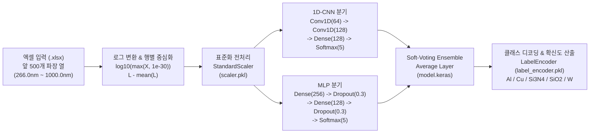

# Material Classifier — 광산란 스펙트럼 기반 웨이퍼 결함 물질 분류 시스템

반도체 웨이퍼 표면의 나노 입자(결함 물질)에서 측정·시뮬레이션된 **광산란 스펙트럼(Light-scattering spectra)** 데이터를 분석하여 입자의 물질을 자동으로 분류하는 **딥러닝 분류 모델(1D-CNN + MLP Ensemble)** 및 **데스크톱 GUI 애플리케이션(`MaterialAnalysis.exe`)** 프로젝트입니다.

---

## 1. 프로젝트 개요 (Project Overview)

반도체 공정 중 발생하는 나노 스케일 결함 입자는 크기(반경 `20 ~ 150 nm`)와 형상(`Sphere`, `Cube`, `Ellipsoid`, `Cuboid` 등)이 다양하며, 측정 환경(광원 출력, 검출기 감도 등)에 따라 스펙트럼의 절대 세기(Intensity)가 크게 달라질 수 있습니다.

본 프로젝트는 **로그 변환 + 행별 평균 중심화(Row-wise Log-Centering)** 전처리를 통해 스펙트럼의 절대 강도 스케일 변화에 영향을 받지 않는 **스케일 불변(Scale-Invariant)** 특징을 추출하고, **1D-CNN과 MLP의 소프트 보팅 앙상블(Soft-Voting Ensemble)** 모델로 5종의 금속 및 비금속(유전체) 물질을 분류합니다. 또한 비개발자도 엑셀(`.xlsx`) 파일만으로 단건 및 대량 스펙트럼을 즉시 분석할 수 있도록 Windows용 독립 실행 GUI 프로그램을 제공합니다.

### 주요 입출력 사양 (I/O Specification)

| 항목 | 상세 내용 |
| :--- | :--- |
| **입력 데이터 (Input)** | 파장 `266.0nm ~ 1000.0nm` 구간을 균일하게 분할한 **500개 파장 포인트**의 광산란 스펙트럼 (`.xlsx` 파일의 앞 500개 열) |
| **출력 클래스 (Output, 5종)** | • **금속 (Metal):** `Al` (알루미늄), `Cu` (구리), `W` (텅스텐)<br>• **비금속 / 유전체 (Dielectric):** `Si3N4` (질화규소), `SiO2` (이산화규소) |
| **모델 구조 (Architecture)** | `1D-CNN` + `MLP` 병렬 결합 후 `Average` 레이어 기반 확률 평균 앙상블 (`model.keras`) |
| **GUI 애플리케이션** | `CustomTkinter` 기반 일괄 분석 데스크톱 앱 (`GUI/MaterialAnalysis.exe`, PyInstaller 패키징) |

---

## 2. 폴더 및 파일 구조 (Directory Structure)

현재 로컬 저장소는 모델 학습(`deep_learning/`), 배포용 GUI 및 추론 모델(`GUI/`), 검증용 데이터(`testfile/`)의 3개 디렉토리로 구성되어 있습니다.

```text
material_classifier/
├── README.md                                   # 프로젝트 종합 문서
├── deep_learning/                              # 딥러닝 모델 학습 코드, 학습 데이터 및 학습 산출물
│   ├── material_classifier_v3.py               # 전처리, 데이터 증강, 1D-CNN+MLP 앙상블 학습 스크립트
│   ├── particle_dataset_all_materials.xlsx     # 학습용 원본 광산란 스펙트럼 데이터셋 (1,720행 × 510열)
│   └── models/                                 # 학습 완료된 모델 및 전처리 객체 보관 폴더
│       ├── model.keras                         # 학습된 1D-CNN + MLP 앙상블 모델 (Keras 3)
│       ├── scaler.pkl                          # 500차원 파장 특징 표준화 스케일러 (StandardScaler)
│       └── label_encoder.pkl                   # 5종 물질 클래스 라벨 인코더 (LabelEncoder)
├── GUI/                                        # 최종 사용자용 GUI 실행 파일 및 외부 참조 모델 파일
│   ├── MaterialAnalysis.exe                    # CustomTkinter 기반 일괄 분석 Windows 실행 파일 (PyInstaller)
│   ├── model.keras                             # GUI 추론용 앙상블 모델 (deep_learning/models/와 동일)
│   ├── scaler.pkl                              # GUI 추론용 표준화 스케일러
│   └── label_encoder.pkl                       # GUI 추론용 클래스 라벨 인코더
└── testfile/                                   # 프로그램 검증 및 스케일 불변성 테스트용 엑셀 데이터셋
    ├── particle_testset_all_materials.xlsx     # 기본 다중 스펙트럼 검증셋 (290행 × 510열, 4종 형상 포함)
    ├── testset_1_x2.xlsx                       # 스케일 불변성 검증셋 — 원본 스펙트럼 × 2
    ├── testset_2_x0.5.xlsx                     # 스케일 불변성 검증셋 — 원본 스펙트럼 × 0.5
    ├── testset_3_x10.xlsx                      # 스케일 불변성 검증셋 — 원본 스펙트럼 × 10
    ├── testset_4_x0.1.xlsx                     # 스케일 불변성 검증셋 — 원본 스펙트럼 × 0.1
    ├── testset_5_x100.xlsx                     # 스케일 불변성 검증셋 — 원본 스펙트럼 × 100
    ├── testset_6_div_max.xlsx                  # 최댓값 정규화 검증셋 — 각 행을 최댓값(max)으로 나눈 [0, 1] 데이터
    └── Test_spectrum_변환.xlsx                 # 미지 물질 단건 예측 테스트용 보간 스펙트럼 (1행 × 503열)
```

> **참고:** `GUI/` 폴더의 `model.keras`, `scaler.pkl`, `label_encoder.pkl`은 `deep_learning/models/`의 파일과 동일하며, `MaterialAnalysis.exe`가 실행 시 동일 폴더에서 외부 파일로 직접 로드하도록 설계되어 있습니다. 따라서 GUI를 다시 빌드하지 않고 이 3개 파일만 교체하면 최신 학습 모델을 즉시 적용할 수 있습니다.

### `testfile/` 검증 데이터셋 상세 설명

`testfile/` 내 모든 엑셀 파일은 코드 내 하드코딩된 경로로 참조되지 않으며, 사용자가 GUI 프로그램(`MaterialAnalysis.exe`)의 파일 선택 창에서 직접 불러와 모델 성능을 검증하기 위한 파일들입니다.

| 파일명 | 크기 (행 × 열) | 컬럼 구성 및 데이터 특성 | 검증 용도 |
| :--- | :---: | :--- | :--- |
| `particle_testset_all_materials.xlsx` | `290 × 510` | 앞 500열: `266.0nm ~ 1000.0nm` 원본 산란 세기<br>뒤 10열: `Shape`, `Material`, `Radius_X/Y/Z(nm)`, `Span_X/Y/Z(nm)`, `Mesh_dx(nm)`, `Sim_time(s)`<br>(5종 물질 각 58건 / `Ellipsoid` 100, `Cuboid` 100, `Sphere` 45, `Cube` 45) | **다중 스펙트럼 기본 검증 및 미학습 형상 일반화 테스트**<br>(학습셋에 없던 `Cuboid` 형상 100건 포함) |
| `testset_1_x2.xlsx` | `290 × 510` | 기본 테스트셋의 500개 스펙트럼 값에 **× 2** 적용 (메타데이터 동일) | **스케일 불변성 검증** (신호 2배 증폭) |
| `testset_2_x0.5.xlsx` | `290 × 510` | 기본 테스트셋의 500개 스펙트럼 값에 **× 0.5** 적용 (메타데이터 동일) | **스케일 불변성 검증** (신호 0.5배 감쇠) |
| `testset_3_x10.xlsx` | `290 × 510` | 기본 테스트셋의 500개 스펙트럼 값에 **× 10** 적용 (메타데이터 동일) | **스케일 불변성 검증** (신호 10배 증폭) |
| `testset_4_x0.1.xlsx` | `290 × 510` | 기본 테스트셋의 500개 스펙트럼 값에 **× 0.1** 적용 (메타데이터 동일) | **스케일 불변성 검증** (신호 0.1배 감쇠) |
| `testset_5_x100.xlsx` | `290 × 510` | 기본 테스트셋의 500개 스펙트럼 값에 **× 100** 적용 (메타데이터 동일) | **스케일 불변성 검증** (신호 100배 증폭) |
| `testset_6_div_max.xlsx` | `290 × 510` | 기본 테스트셋의 각 행을 해당 행의 최댓값(`max`)으로 나누어 `[0, 1]` 범위로 정규화 | **최댓값 정규화(Max-Normalization) 데이터 일관성 검증** |
| `Test_spectrum_변환.xlsx` | `1 × 503` | 앞 500열: `266.0nm ~ 1000.0nm` 보간 스펙트럼<br>뒤 3열: `Shape` (`Unknown`), `Material` (`Unknown`), `Source` (`Test_spectrum.xlsx (20nm 간격 41점 -> log-PCHIP 보간)`) | **미지 물질 단건(Single-sample) 추론 테스트**<br>저해상도(41점) 외부 스펙트럼을 500점으로 보간한 실전 입력 검증 |

---

## 3. 주요 기능 및 모델 파이프라인 (Key Features & Pipeline)



### 3.1 데이터 정제, 전처리 및 증강 (`deep_learning/material_classifier_v3.py`, `.pkl`)

1. **학습 데이터셋 구성 및 필터링**
   - `particle_dataset_all_materials.xlsx`에는 5종 물질(`Al`, `Cu`, `Si3N4`, `SiO2`, `W`)별 344건씩 총 1,720건(`Sphere` 610, `Cube` 610, `Ellipsoid` 500, 반경 `20 ~ 150 nm`)이 수록되어 있습니다.
   - 학습 시 시뮬레이션 특이 조건에 해당하는 `Shape == "Cube"` 및 `Radius_X(nm) in [30, 45]` 샘플 10건을 제외한 1,710건을 사용하며, 클래스 비율을 유지하는 층화 분할(`train_test_split`, `test_size=0.15`, `stratify=y_all`)로 학습/검증 데이터를 나눕니다.
2. **스케일 불변 로그 중심화 (`to_log`, `center`)**
   - 각 스펙트럼 행 $X$에 대해 수치 안정성을 위한 하한 클리핑(`1e-30`) 후 상용로그를 취하고, 해당 행의 평균을 뺍니다:
     $$L = \log_{10}(\max(X, 10^{-30})), \qquad L_{\text{centered}} = L - \frac{1}{500}\sum_{i=1}^{500} L_i$$
   - 스펙트럼 전체에 임의의 양수 배율 $k$를 곱하더라도($k \cdot X$), 로그 공간에서는 상수 $\log_{10}(k)$가 더해질 뿐이며 행별 평균을 빼는 과정에서 정확히 상쇄됩니다. 덕분에 `testset_1_x2.xlsx` ~ `testset_6_div_max.xlsx`처럼 강도 스케일이 크게 변하거나 최댓값 정규화된 입력에서도 동일한 특징 표현을 얻습니다.
3. **데이터 증강 (`augment`)**
   - 측정 노이즈와 스케일 변동을 모사하기 위해 가우시안 곱셈 노이즈($\mathcal{N}(0, 0.03)$, 하한 `0.05` 클리핑) 및 무작위 배율 시프트(`0.5 ~ 2.0`배)를 적용한 뒤 재중심화합니다.
   - 학습 데이터는 원본 1배 + 증강 8배(총 **9배**)로 확장하고, 검증 데이터에도 증강을 1회 적용하여 일반화 성능을 평가합니다.
4. **전처리 객체 저장 (`.pkl`)**
   - `scaler.pkl` (`sklearn.preprocessing.StandardScaler`): 증강된 학습 데이터의 500개 파장 특징별 평균과 표준편차를 저장하여 추론 시 동일한 정규화를 적용합니다.
   - `label_encoder.pkl` (`sklearn.preprocessing.LabelEncoder`): 5종 물질 문자열 라벨(`['Al', 'Cu', 'Si3N4', 'SiO2', 'W']`)과 정수 인덱스(`0 ~ 4`) 간 매핑을 저장합니다.

### 3.2 딥러닝 앙상블 모델 아키텍처 (`model.keras`)

국소 파장 패턴(피크·기울기·공명 구조)을 잘 포착하는 **1D-CNN**과 전 파장 대역의 전역적 상관관계를 학습하는 **MLP**를 개별 학습한 뒤, 두 모델의 Softmax 확률 분포를 평균 내는 앙상블 모델(`model.keras`)로 결합합니다.

| 구성 모델 | 주요 레이어 구조 | 학습 설정 |
| :--- | :--- | :--- |
| **1D-CNN (`cnn`)** | `Input(500)` → `Reshape((500, 1))`<br>→ `Conv1D(64, kernel=5, ReLU, same)` → `BatchNorm` → `MaxPool1D(2)`<br>→ `Conv1D(128, kernel=5, ReLU, same)` → `BatchNorm` → `MaxPool1D(2)`<br>→ `Flatten` → `Dense(128, ReLU)` → `BatchNorm` → `Dense(5, Softmax)` | • Optimizer: `Adam`<br>• Loss: `sparse_categorical_crossentropy`<br>• `epochs=200`, `batch_size=64`<br>• `EarlyStopping(val_loss, patience=10, restore_best_weights=True)` |
| **MLP (`mlp`)** | `Input(500)`<br>→ `Dense(256, ReLU)` → `Dropout(0.3)`<br>→ `Dense(128, ReLU)` → `Dropout(0.3)`<br>→ `Dense(5, Softmax)` | 동일 |
| **Ensemble (`model.keras`)** | `Input(500)` → `[cnn(inp), mlp(inp)]` → `Average()` → 5-Class 확률 출력 | Soft-Voting 결합 저장 |

### 3.3 GUI 애플리케이션 실행 흐름 (`GUI/MaterialAnalysis.exe`)

`MaterialAnalysis.exe`는 Python 3.12와 `CustomTkinter` 기반의 다크 모드 데스크톱 앱(**Material Analysis System**, 창 크기 `640×720`)을 PyInstaller로 패키징한 프로그램입니다.

1. **모델·전처리 파일 자동 탐색:** 실행 시 `.exe`와 같은 폴더에 `model.keras`, `scaler.pkl`, `label_encoder.pkl`이 있는지 확인합니다.
2. **엑셀 파일 선택 및 유효성 검사:** 사용자가 `.xlsx` 파일을 선택하면 `openpyxl` 엔진으로 로드하고 빈 행을 제거한 뒤, 앞 500개 열의 수치 데이터를 추출합니다. 열 개수가 500개 미만이면 오류를 안내하며, 특정 행에 결측치나 숫자가 아닌 값이 있으면 해당 행만 오류로 분리 표기합니다.
3. **비동기 일괄 추론:** 백그라운드 스레드(`threading.Thread`)에서 프로그레스 바를 표시하며 학습 시와 동일한 전처리(`log10` → 행별 중심화 → `StandardScaler`) 및 앙상블 추론을 수행합니다.
4. **확신도 기반 색상 시각화 및 요약 출력:** 각 엑셀 행 번호 기준으로 예측 물질명과 확신도(`%`)를 색상 태그로 구분해 표시하고, 하단에 총 분석 건수 및 물질별 분포 요약을 출력합니다.
   - 🟢 **초록 (`#22C55E`):** 확신도 90% 이상
   - 🟡 **노랑 (`#FACC15`):** 확신도 70% ~ 90%
   - 🟠 **주황 (`#FB923C`):** 확신도 70% 미만
   - 🔴 **빨강 (`#EF4444`):** 결측치·비수치 값 등 데이터 오류 행

---

## 4. 설치 및 실행 방법 (Getting Started)

### 4.1 일반 사용자: `.exe` 파일과 `testfile/`로 바로 테스트하기 (Windows)

별도의 Python 설치나 환경 설정 없이 바로 테스트할 수 있습니다.

1. **`GUI/` 폴더 구성 확인**
   `GUI/` 폴더 안에 아래 4개 파일이 함께 위치해 있는지 확인합니다.
   - `MaterialAnalysis.exe`
   - `model.keras`
   - `scaler.pkl`
   - `label_encoder.pkl`
2. **프로그램 실행**
   `GUI/MaterialAnalysis.exe`를 더블 클릭하여 **Material Analysis System** 창을 실행합니다.
   *(단일 실행 파일 압축 해제 및 TensorFlow 초기화로 인해 최초 실행 시 수 초~수십 초가 소요될 수 있습니다.)*
3. **테스트 파일 선택 및 분석**
   - **`파일 선택 및 일괄 분석 시작`** 버튼을 클릭합니다.
   - `testfile/` 폴더에서 검증할 엑셀 파일을 선택합니다:
     - **다중 스펙트럼 검증:** `testfile/particle_testset_all_materials.xlsx` (290건 일괄 분석)
     - **스케일 불변성 확인:** `testfile/testset_1_x2.xlsx` ~ `testfile/testset_6_div_max.xlsx` (원본과 동일한 예측 결과 유지 여부 확인)
     - **단건 미지 물질 추론:** `testfile/Test_spectrum_변환.xlsx` (1건 즉시 추론)
4. **결과 확인**
   분석이 완료되면 결과 창에 엑셀 행 번호별 예측 물질, 확신도 색상 표시, 그리고 전체 물질별 집계 요약이 출력됩니다.

---

### 4.2 개발자: Python 환경에서 모델 재학습 및 배포하기

#### 1) 권장 환경 및 필수 라이브러리 설치

- **Python 버전:** Python 3.12 권장 (`MaterialAnalysis.exe` 패키징 기준)
- **필수 패키지 설치:**

```bash
pip install numpy pandas openpyxl scikit-learn joblib tensorflow
```

> GUI 개발·수정 또는 PyInstaller 패키징을 진행하는 경우 `customtkinter`와 `pyinstaller`를 추가로 설치합니다:
> ```bash
> pip install customtkinter pyinstaller
> ```

#### 2) 모델 재학습 실행

`deep_learning/material_classifier_v3.py`는 현재 작업 디렉토리에서 `particle_dataset_all_materials.xlsx`를 읽고 결과 파일을 저장하므로, `deep_learning/` 디렉토리로 이동해 실행합니다.

```bash
cd deep_learning
python material_classifier_v3.py
```

실행이 완료되면 `deep_learning/` 폴더에 아래 파일들이 생성됩니다:
- `model.keras` (최종 1D-CNN + MLP 앙상블 모델)
- `cnn.keras`, `mlp.keras` (개별 분기 모델)
- `scaler.pkl`, `label_encoder.pkl` (전처리 스케일러 및 라벨 인코더)

#### 3) 학습된 최신 모델을 GUI에 반영하기

재학습으로 생성된 핵심 파일 3종(`model.keras`, `scaler.pkl`, `label_encoder.pkl`)을 `deep_learning/models/`에 백업하고 `GUI/` 폴더에 덮어쓰기하면, `MaterialAnalysis.exe`를 다시 빌드하지 않고도 즉시 최신 모델로 추론할 수 있습니다.

```powershell
# PowerShell 기준 (프로젝트 루트에서 실행)
Copy-Item deep_learning\model.keras, deep_learning\scaler.pkl, deep_learning\label_encoder.pkl -Destination deep_learning\models\ -Force
Copy-Item deep_learning\model.keras, deep_learning\scaler.pkl, deep_learning\label_encoder.pkl -Destination GUI\ -Force
```

---

## 5. 사용자 정의 엑셀 파일 입력 규격 (Custom Input Format)

직접 측정하거나 시뮬레이션한 새로운 광산란 스펙트럼 파일을 `MaterialAnalysis.exe`로 분석하려면 아래 형식을 맞춰야 합니다.

- **파일 형식:** `.xlsx` (Excel 통합 문서, 첫 번째 시트 기준)
- **행 구성:** 1행은 헤더(컬럼명), 2행부터 각 행이 하나의 입자 스펙트럼 샘플
- **열 구성:** **앞 500개 열(1열 ~ 500열)** 에 `266.0nm ~ 1000.0nm` 구간 500개 파장 포인트의 양수 스펙트럼 강도 값이 순서대로 배치되어야 합니다.
- **메타데이터 열:** 501번째 열 이후의 추가 컬럼(`Shape`, `Material`, `Source` 등)은 선택 사항이며 추론 시 자동으로 무시됩니다.
- **파장 포인트 수가 다른 경우:** `testfile/Test_spectrum_변환.xlsx` 사례와 같이 측정 장비의 파장 간격이 다른 경우(예: 20 nm 간격 41점), **log-PCHIP 보간** 등을 통해 `266.0nm ~ 1000.0nm` 500개 파장 그리드로 리샘플링한 뒤 입력해야 정확한 분류가 가능합니다.
